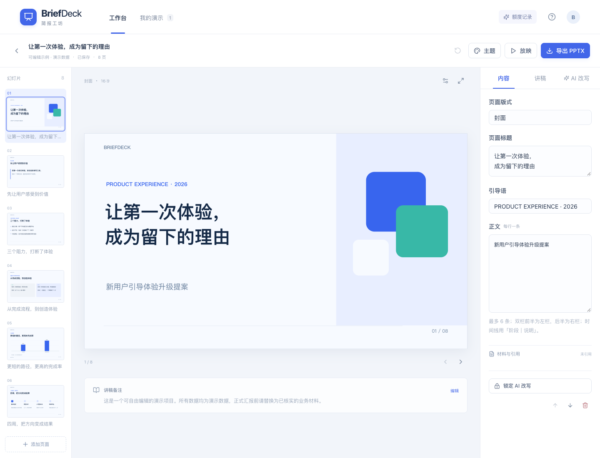

# BriefDeck｜简报工坊

将主题与工作材料变成可编辑的汇报 PPT。先确认大纲，再分批生成内容；预览、修改、下载后继续在 PowerPoint 或 WPS 中编辑。

**交付状态：应用已实现，本地和模拟宿主验证已完成；Anna staging 真实模型测试、账号额度核验、审核上架和 GitHub 远程仓库发布尚待账号登录完成。不能将本地 mock 测试视为真实平台测试。**

| 信息 | 当前值 |
| --- | --- |
| App name | BriefDeck｜简报工坊（拟提交） |
| slug | `briefdeck`（待平台创建确认） |
| 版本 | `0.1.0` |
| 平台 | https://staging.anna.partners |
| GitHub | 尚未创建远程仓库 |
| 开发测试实际 CU | 尚无真实模型请求；账号余额未核验 |



## 体验

1. 输入主题、受众、目的，选择 6/8/10/12 页，可粘贴材料或导入 `.txt`、`.md`。
2. 点击生成大纲，修改标题、页面目的、顺序和版式，再生成页面。
3. 编辑文字、图表、讲稿与主题；也可以对单页进行 AI 改写，并选择应用或放弃候选。
4. 下载 `.pptx`，其中的文本、图形与图表保持为原生可编辑对象。

在本地预览中，AI 按钮会明确禁用；点击「体验示例」可使用完整编辑器、项目保存、主题和 PPTX 导出。示例中的 42% 与 68% 为演示数据。

## 运行

要求 Node.js 22.12+。安装依赖后：

```sh
npm ci
npm run dev
```

打开终端打印的地址，默认 `http://127.0.0.1:5173`。不需要模型密钥。

```sh
npm test                 # 数据、AI 边界、并发存储与 PPTX 结构测试
npm run test:e2e         # Chrome，桌面、375px、真实 SDK + 模拟宿主工作流
npm run build           # 类型检查与静态资源构建，输出 bundle/
npm run anna:validate   # Anna schema 与 Host API 静态检查
```

本地浏览器测试使用已安装的 Chrome；CI 安装 Playwright Chromium。CI 不调用任何付费模型。

## 在 Anna 中开发与发布

还需要安装 `uv`，并在网页中完成邮箱验证、开发者身份激活。CLI 已作为开发依赖锁定。

```sh
npx anna-app doctor
npx anna-app login --host https://staging.anna.partners
npx anna-app whoami
npx anna-app account set-handle your-dev-handle --host https://staging.anna.partners
npm run build
npm run anna:dev
```

`anna:dev` 使用官方 harness，关闭模型，便于零额度验证 SDK、UI 和样例编辑。`anna:mock` 提供 8 页固定大纲，用于大纲界面检查；CLI 0.1.64 的 mock 选择器对对象消息的匹配存在限制，完整生成工作流由 `test:e2e` 中的动态模拟宿主覆盖。这里不修改平台 CLI。

真实调用：

```sh
npm run anna:real
```

**已核对的 CLI 0.1.64 没有 `--llm real` 或 `--llm mock` 参数。** 无 `--no-llm` / `--mock-llm` 时使用账号真实调用，真实调用计入账号额度。

在 staging 草稿上传后，必须完成这些检查：

1. 确认题目提供的初始额度到账，记录余额。
2. 真实生成大纲、生成页面、改写一页，核对用量。
3. 关闭并重开窗口，确认 APS 保存和恢复。
4. 生成 PPTX，确认平台文件上传及宿主下载。
5. 从上传返回的 `put_url` 确定对象存储 origin，将精确 HTTPS origin 加入 `manifest.json` 的 `ui.bundle.external_origins`，重新构建上传。当前列表为空，不能假定 staging 文件 PUT 的 CSP 已经配置完成。
6. 通过独立账号验证安装、生成、下载与数据隔离。

具体发布步骤见 [docs/release.md](docs/release.md)。

## 产品与工程

- 六种版式：封面、核心结论、要点、双栏、图表、时间线。
- 三种主题：清澈蓝、留白、深空。
- 默认 8 页正文分三批，每批最多 3 页；已完成页面立即保留。
- 每次模型调用显式限制输出，检测 `stopReason=maxTokens`。
- JSON/结构错误每次最多一次自动修复，整次操作最多两次；网络超时不自动重试。
- 图表数值必须存在于引用材料中；缺少依据时降级为定性页面。这个校验不等于事实核查。
- 单页改写预览不直接覆盖原稿，图表数据禁止被改写。
- 手动编辑、切换主题与 PPTX 导出不调用模型。
- 模型、存储使用 Anna SDK；浏览器中没有开发者 PAT 或第三方模型 Key。

详细说明见 [架构](docs/architecture.md)、[测试报告](docs/test-report.md)、[隐私](docs/privacy.md)。

## 兼容性与范围

主输出为 16:9 PPTX；支持原生柱状图和折线图、讲稿、项目 JSON 备份。第一版不解析 PDF/DOCX，不生成图片，不进行联网研究。

已在 Chrome 验证浏览器下载；已由 LibreOffice 读取八页 PPTX 并导出 PDF，检查中文文本与图表。尚未在 Windows PowerPoint 和 WPS 人工验收，且不声称所有办公软件像素一致。

导出字体为 Microsoft YaHei，缺失时由办公软件回退。预览与导出共用坐标与换行逻辑；不同字体、原生图表渲染仍可能产生差异。出现布局警告时可以先调整，也可以导出后在办公软件继续修改。

## 开源

本项目代码使用 MIT；第三方依赖保留各自许可证。图标来自 lucide-react；未使用外部图片或远程字体服务。
