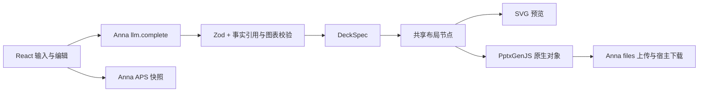

# 架构与决策

BriefDeck 是 schema 4 的 Anna 静态 SPA，不依赖自建后端或自定义 Executa。

## 模块

- `src/domain.ts`：Brief、Outline、Slide、Project schema；材料引用和图表数字约束。
- `src/anna.ts`：动态加载 Anna 宿主 SDK，AI 调用、用量、APS 快照、文件下载；独立浏览器使用明确的本地存储。
- `src/render.tsx`：六种模板、文本换行与溢出提示、SVG 预览、原生 PPTX 导出。
- `src/App.tsx`：创建、大纲、编辑器、项目库、讲稿、改写候选、主题和用量。

## AI 调用

大纲一次（上限 2200 tokens），正文每批最多三页（3000），单页改写（1800）。关闭可关闭的 thinking。输出必须通过 JSON 与 schema 校验；截断、缺页、错序、重复 ID 不能静默通过。

材料按段分配 R1…Rn；超过一百行时合并成最多一百组，保留所有材料文字。图表数字必须存在于对应引用段落中；不符合时转换为「数据待核实」页面。这个约束不证明数字与标签的语义对应，用户仍需核验。

修复只用于语法与 schema 错误，每个调用最多一次，整次操作最多两次；每次修复单独记录 CU。网络失败和截断不自动重试。停止操作只停止后续批次，已经在运行的模型调用可能仍被计费。

## 持久化

生产使用自身 app scope，无需跨应用数据权限。先写入不可变 `projects/<id>/snapshots/<revision>-<uuid>/{brief,outline,slides}`，成功后通过 etag 切换 `projects/<id>/meta` 指针。读取时只读取指针指向的快照，避免混合修订。

同一 Repository 的保存串行执行；多个窗口使用 `if_match` 检测冲突。后台尽力清理两次修订以前的快照。手动编辑防抖 800ms 保存，生成批次立即保存；关闭前应看到「已保存」。失败会显式提示，不能将显示中的未保存内容当作已持久化。

本地预览只读取本地项目；Anna 模式只读取当前账号的 APS，避免把其他本地身份的项目混入平台账号。

## 导出与安全边界

统一 1280×720 设计坐标，转换为 13.333×7.5 英寸。文本、形状、图表分别生成原生对象；讲稿写入 notes，不将整页截图作为 PPT 内容。

Anna 内使用 `files.upload_init → PUT → upload_finalize → files.download`。平台宿主处理下载。精确对象存储 origin 需要在首次 staging 实测后加入 CSP，当前未完成此配置。

独立浏览器使用 Blob 下载。项目 JSON 备份目前走浏览器下载，Anna iframe 是否允许此辅助备份通道仍需实测；PPTX 主通道使用平台宿主下载。

不执行模型返回的 HTML/JS，不向浏览器下发 PAT。所有模型输入是文本/JSON，渲染通过 React/SVG 文本节点完成。

## 当前环境限制

模型、下载、账号隔离必须在真实 staging 中验收。模拟宿主验证的是 SDK 桥与应用编排，不验证 Anna 服务端、模型供应商、CU 账单或平台审核。
